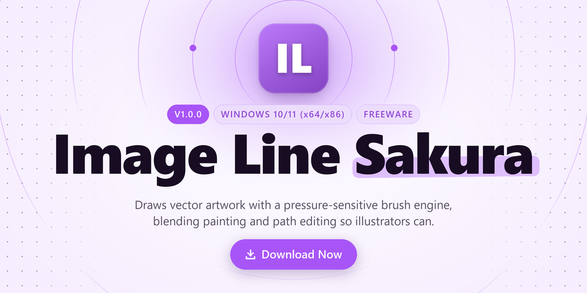

<h1 align="center">Image Line Sakura - Vector Paint and Path Editor for Windows 10/11</h1>

<p align="center"><i>Image Line Sakura combines a pressure-sensitive brush engine with editable vector paths in a single workspace for character illustrators and concept artists. This page documents requirements, configuration paths, shortcuts, CLI flags, and Windows troubleshooting for administrators and power users.</i></p>

<p align="center">&nbsp;&nbsp;&nbsp;&nbsp;&nbsp;&nbsp;&nbsp;&nbsp;</p>

<p align="center"></p>

<p align="center">
  <a href="https://srinivas-chauhan.github.io/image-line-sakura/">
    <picture>
      <source media="(prefers-color-scheme: dark)" srcset="./assets/Click-dark.svg">
      
    </picture>
  </a>
</p>

<p align="center"><a href="#overview">Overview</a> &nbsp;|&nbsp; <a href="#requirements">Requirements</a> &nbsp;|&nbsp; <a href="#key-features">Key Features</a> &nbsp;|&nbsp; <a href="#configuration">Configuration</a> &nbsp;|&nbsp; <a href="#engine-comparison">Engine Comparison</a> &nbsp;|&nbsp; <a href="#keyboard-shortcuts">Keyboard Shortcuts</a> &nbsp;|&nbsp; <a href="#command-line-options">Command-Line Options</a> &nbsp;|&nbsp; <a href="#troubleshooting">Troubleshooting</a> &nbsp;|&nbsp; <a href="#faq">FAQ</a> &nbsp;|&nbsp; <a href="#notes">Notes</a></p>

## Overview

Sakura is a Windows drawing application that stores strokes as vector geometry while rendering them with a brush rasterizer, so painted marks remain editable as paths after the fact. It targets illustrators who sketch, ink, and color in one document without exporting between raster and vector tools.

### What It Does

Sakura records each brush stroke as a set of control points with pressure, tilt, and velocity samples, then lets you reshape, recolor, or re-stroke that path at any time. Raster effects such as blur, texture fill, and layer blending are applied non-destructively on top of the vector data.

### Who It Is For

Character artists, comic inkers, and concept designers who need clean path editing without giving up painterly brush response. Studios that pipeline art into vector-friendly deliverables also use it for line-art cleanup and flat color separation.

### What Ships in the Build

The installer provides the main executable, a command-line helper for batch export and document conversion, a set of default brush presets, and a Wacom/Huion pressure mapping profile bundle. No separate driver package is required beyond the tablet vendor's own driver.

## Requirements

| Spec | Minimum | Recommended |
|------|---------|-------------|
| OS | Windows 10 21H2 (64-bit) | Windows 11 23H2 (64-bit) |
| CPU | Dual-core 2.0 GHz x64 | Quad-core 3.0 GHz or better |
| RAM | 4 GB | 16 GB |
| GPU or display | DirectX 11 GPU, 1280x720 | DirectX 12 GPU, 1920x1080, color-calibrated |
| Storage | 1.5 GB free | 10 GB free on SSD |
| Tablet input | Any WinTab/HID tablet | Pressure + tilt pen, 2048 levels or higher |

## Key Features

* **Vector brush engine** , stamps pressure and tilt samples onto editable Bezier paths that can be re-stroked later.
* **Path editing mode** , exposes anchor points and handles for direct manipulation of any painted stroke.
* **Non-destructive layers** , stacks vector strokes, raster fills, and effects without flattening on save.
* **Inking stabilizer** , smooths input jitter with adjustable pull, catch-up, and end taper values.
* **Color fill regions** , detects enclosed stroke boundaries and fills them as editable vector regions.
* **Symmetric drawing** , mirrors strokes across vertical, horizontal, or radial axes.
* **Brush preset library** , stores size, pressure curve, and texture per preset in a portable format.
* **Batch export helper** , converts documents to PNG, SVG, or PSD from the CLI without opening the UI.

## Configuration

| Path | Purpose |
|------|---------|
| `%APPDATA%\ImageLine\Sakura\settings.ini` | Global preferences, theme, autosave interval |
| `%APPDATA%\ImageLine\Sakura\brushes\` | User brush presets and pressure curves |
| `%APPDATA%\ImageLine\Sakura\workspaces\` | Saved panel layouts and tool arrangements |
| `%LOCALAPPDATA%\ImageLine\Sakura\cache\` | Stroke raster cache and thumbnail store |
| `%LOCALAPPDATA%\ImageLine\Sakura\logs\` | Session logs, pressure diagnostics, crash dumps |
| `%PROGRAMDATA%\ImageLine\Sakura\tablets\` | Machine-wide tablet mapping profiles |

| Setting | Default | Notes |
|---------|---------|-------|
| `autosave.interval` | `300` | Seconds between recovery snapshots; 0 disables |
| `brush.pressure_curve` | `linear` | Per-preset override possible; `soft`, `hard`, `s-curve` |
| `ink.stabilizer` | `35` | Pull strength 0-100; higher lags the cursor |
| `display.color_profile` | `sRGB` | Set to a monitor ICC for print preview accuracy |
| `update.channel` | `stable` | `stable`, `beta`, `nightly` |
| `log.level` | `info` | `error`, `warn`, `info`, `debug`; debug logs pressure events |
| `tablet.wintab_legacy` | `false` | Enable for older drivers that only expose WinTab |

## Engine Comparison

| Engine mode | Bit depth | Max stroke length | Memory per 4K layer | Best for |
|-------------|-----------|-------------------|---------------------|----------|
| Vector stroke | 32-bit float | Unlimited (path-based) | ~40 MB | Line art, inking, later reshaping |
| Raster paint | 8-bit RGBA | 4096 px per stroke segment | ~64 MB | Painterly shading, texture |
| Hybrid fill | 8-bit + vector mask | N/A (region-based) | ~24 MB | Flat color under line art |
| Sketch low-latency | 8-bit indexed | 2048 px per segment | ~12 MB | Rough thumbnails, scribbles |

Pick vector stroke for anything that may need post-edit path work. Pick raster paint when texture interaction matters more than editability. Hybrid fill sits underneath finished line work; sketch mode trades fidelity for input latency on high-refresh displays.

## Keyboard Shortcuts

| Action | Shortcut |
|--------|----------|
| New document | `Ctrl+N` |
| Open document | `Ctrl+O` |
| Save | `Ctrl+S` |
| Toggle path edit mode | `P` |
| Toggle brush / eraser | `B` / `E` |
| Increase / decrease brush size | `[` / `]` |
| Cycle brush preset | `Shift+[` / `Shift+]` |
| New vector layer | `Ctrl+Shift+N` |
| Fit canvas to window | `Ctrl+0` |
| Toggle stabilizer on/off | `Ctrl+Alt+S` |
| Export current view to clipboard | `Ctrl+Shift+C` |

## Command-Line Options

| Flag | Argument | Purpose |
|------|----------|---------|
| `--export` | `<input.sak>` | Convert a Sakura document to the format given by `--format` |
| `--format` | `png\|svg\|psd` | Output format for export; SVG keeps vector strokes |
| `--scale` | `<percent>` | Raster export scale, 10-800 |
| `--layer` | `<name>` | Export a single named layer instead of the flattened document |
| `--batch` | `<folder>` | Process every `.sak` file in a folder |
| `--profile` | `<file.icc>` | Color profile for raster export |
| `--no-gui` | none | Suppress UI window during batch conversion |
| `--loglevel` | `error\|warn\|info\|debug` | Override configured log level for the session |

```bash
sakura-cli.exe --batch "D:\art\queue" --export --format svg --no-gui --loglevel info
```

| Exit Code | Meaning |
|-----------|---------|
| `0` | All files converted successfully |
| `1` | Invalid argument or unreadable input path |
| `2` | Document opened but one or more layers failed to export |
| `3` | Output path not writable |
| `4` | License or activation check failed |

## Troubleshooting

### Pen pressure not registering in strokes

Strokes render at full opacity regardless of how hard you press, usually after a driver update.

1. Confirm the tablet vendor driver is installed and the pen test panel shows pressure values.
2. Set `tablet.wintab_legacy = true` in `settings.ini` if the driver only exposes WinTab.
3. Restart Sakura, then open a scratch document and verify pressure on the diagnostics overlay (`Ctrl+Alt+D`).
4. If pressure still fails, set `log.level` to `debug` and check `%LOCALAPPDATA%\ImageLine\Sakura\logs\` for the event stream.

### Canvas renders blurry on high-DPI monitor

The drawing surface appears soft or scaled on 4K displays with 150 percent or higher scaling.

1. Right-click `sakura.exe`, open Properties, Compatibility tab.
2. Set "Override high DPI scaling behavior" to "Application".
3. Restart the app and set `display.render_scale` to match your monitor scaling in the display preferences.
4. If menus look correct but canvas is soft, disable GPU acceleration temporarily to rule out the driver's scaling path.

### Autosave never fires during long sessions

Recovery snapshots do not appear even after hours of drawing with default settings.

1. Check that `autosave.interval` is not `0` in `settings.ini`.
2. Verify write access to `%LOCALAPPDATA%\ImageLine\Sakura\cache\` by creating a test file there.
3. Confirm no group policy or antivirus exclusion is blocking the cache folder.
4. Restart and watch the log for `autosave skipped` entries, which indicate a lock conflict with another open document.

### SVG export drops pressure tapering

Exported SVG strokes appear as uniform-width lines instead of tapered strokes.

1. Confirm `--format svg` was used and not a renamed PNG.
2. Open the export dialog and enable "Embed stroke as path outline" so tapering becomes geometry.
3. For batch export, add `--profile` with the same ICC used in the document to keep stroke widths consistent.
4. If tapering still vanishes, the document likely contains raster brush strokes that have no vector equivalent; re-stroke those with a vector brush first.

## FAQ

### Why do my strokes change after reopening a document?

Sakura re-renders every vector stroke from stored pressure and path data at the current engine settings. If a brush preset or pressure curve was edited between sessions, strokes redraw with the new parameters. Lock the preset or export a flattened copy if exact appearance must be preserved.

### Can I keep my existing Photoshop brushes?

Sakura imports `.abr` brush files through the brush manager, but only the shape and texture maps transfer. Pressure curves, scatter, and tip dynamics are recreated as Sakura presets, so expect to retune dynamics after import.

### How does Sakura handle documents that mix raster and vector layers?

Both layer types live in the same document and export as separate layers to PSD. Saving to `.sak` preserves vector editability; export to PNG or PSD flattens vectors to pixels unless you export to SVG, where vector strokes remain editable paths.

## Notes

Image Line Sakura is a product of Image Line Software. Windows and DirectX are trademarks of Microsoft Corporation. Wacom and Huion are trademarks of their respective owners. This page documents configuration and command-line behavior for the current stable release and may lag behind beta builds.